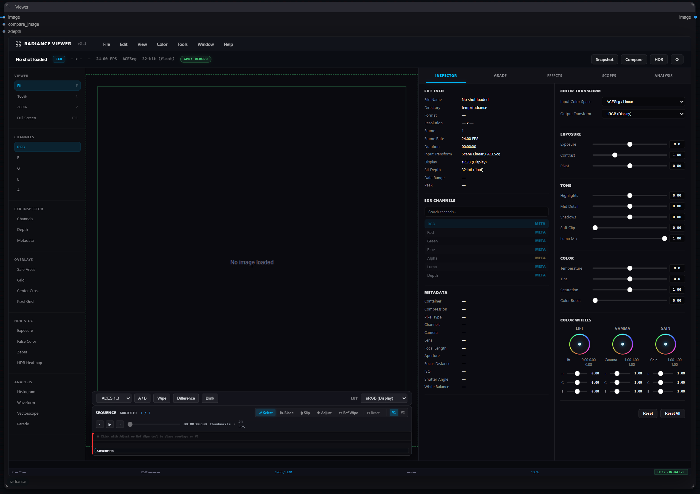
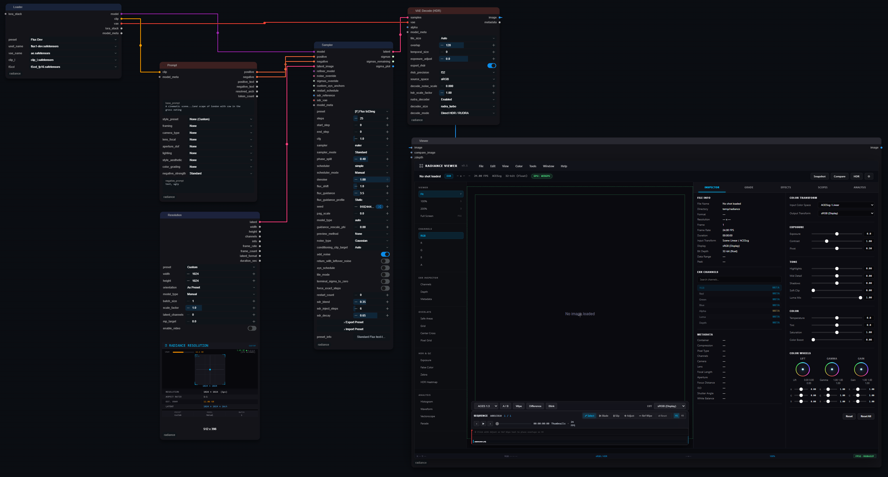

<div align="center">


**HDR, colour management, VFX tools, and image review inside ComfyUI.**

[](https://github.com/fxtd-studios/radiance/releases)
[](CHANGELOG.md)
[](https://registry.comfy.org/nodes/radiance)
[](https://github.com/fxtd-studios/radiance)
[](LICENSE)
[](https://registry.comfy.org/nodes/radiance)
[](https://huggingface.co/fxtdstudios/RUDRA)
[](https://github.com/FXTD-Studios/RUDRA)

Radiance adds 147 visible nodes to ComfyUI for generating and processing images and video in HDR, working with EXR, ACES and OpenColorIO, reviewing shots in a professional viewer, and delivering masters to Nuke and DaVinci Resolve.

[What's new](#whats-new-in-40) · [Install](#installation) · [Quick start](#quick-start) · [Models](#models-and-downloads) · [Workflows](#example-workflows) · [Viewer](#using-the-viewer) · [Delivery](#delivering-masters) · [Docs](#documentation) · [Support](#support)

</div>

## What's new in 4.0

4.0 is in beta on the `version-4-Beta` branch. Read the [changelog](CHANGELOG.md) upgrade notes before moving a production setup.

- **FLUX 3 Image Klein:** base and step-distilled, in the Loader, Sampler, Resolution and Prompt nodes, including reference-image editing and layout tables.
- **Deliver Master:** a graded-master export dialog in the Viewer (**File > Deliver Master…**), with PQ (HDR10) and HLG, 10-bit enforced for HDR, and HDR QC that reports peak nits and clipping.
- **Viewer workspaces:** Review, Color, Inspect and Compare, each showing only the panels it needs.
- **Review tools:** frame bookmarks, notes and strokes on frames, a measured QC pass over the sequence, and an exportable review report.
- **Channels and compare:** Depth and 3D Normal channels, difference with gain and signed mode, onion skin, and compare inputs at their own frame rate.
- **Safer files:** workflow saves, sidecars and DCC frames are written atomically, sequence writes warn about stale frames, and a remote DCC bridge needs signed requests.

## What you can do

| Your task | Radiance tools |
|---|---|
| Generate images and video | Unified Loader with presets (FLUX 3 Klein, FLUX.2, Qwen-Image, Wan, LTX Video and more), Sampler Pro, Cinematic Prompt Encoder, Resolution |
| Create and process HDR | HDR VAE Encode and Decode, SDR → HDR (RUDRA), tone mapping, HDR analysis |
| Manage colour | ACES 2.0, OpenColorIO, colour-space conversion, LUTs, CDL, grading |
| Review images and video | Viewer with workspaces, scopes, compare, review notes and QC |
| Prepare VFX shots | Masks, depth, optical effects, estimated passes, relighting, scene cuts |
| Save and deliver | Read and Write for images, video and EXR sequences; Deliver Master with HDR10 and HLG |
| Hand off to other tools | Nuke and DaVinci Resolve bridges, metadata, project handoff |
| Organize your work | Project Manager, Workflow Library with version history, Assets, Gizmos |

<div align="center">

</div>

## Installation

### With ComfyUI Manager

1. Open **ComfyUI Manager**.
2. Search for **Radiance** and install it.
3. Restart ComfyUI and refresh your browser.

Radiance is also listed in the [Comfy Registry](https://registry.comfy.org/nodes/radiance).

### Manually

Run these commands with the Python environment that runs ComfyUI:

```sh
cd ComfyUI/custom_nodes
git clone https://github.com/fxtd-studios/radiance.git
cd radiance
python -m pip install -r requirements.txt
```

Restart ComfyUI and refresh your browser.

**Windows portable:** install the requirements with ComfyUI's bundled `python_embeded\python.exe`.

**The 4.0 beta:** check out the beta branch after cloning, then install the requirements again:

```sh
git checkout version-4-Beta
python -m pip install -r requirements.txt
```

### Updating

Use **Update** in ComfyUI Manager, or inside the `radiance` folder:

```sh
git pull
python -m pip install -r requirements.txt
```

Restart ComfyUI and refresh your browser after updating. Coming from 3.x? Back up your workflows and read the [upgrade notes](CHANGELOG.md): four placeholder nodes were removed, delivered files are named `Shot_v0002`, and a few controls that did nothing now act.

## Quick start

### Process an existing image

**Read → SDR → HDR Universal → Viewer**

1. Load your image with **Read**.
2. Connect it to **SDR → HDR Universal**.
3. Connect the result to **Viewer** and run the workflow.
4. Add **Write** to save the result as EXR.

The SDR-to-HDR model downloads on first use when downloads are enabled.

### Generate an image

Open the [starter workflow](workflows/start.json) in ComfyUI. It uses FLUX.2 Klein 4B distilled at 1024 × 1024 in 4 steps. Select the model files in the Loader (see [Models and downloads](#models-and-downloads)), enter your prompt and run it. Review the result in the Viewer and connect a Write node to save it.

To use FLUX 3 Image Klein instead, pick the **Flux.3 Klein** preset in the Loader. The Sampler sets the right steps and CFG for the base or distilled model on its own.

<div align="center">

</div>

## Models and downloads

To stop all automatic model downloads, set `RADIANCE_ALLOW_DOWNLOADS=0` before starting ComfyUI. Every automatic download is pinned to a file hash.

### RUDRA for SDR to HDR

[RUDRA on Hugging Face](https://huggingface.co/fxtdstudios/RUDRA) is the learned SDR-to-HDR model behind **SDR → HDR Universal** and **SDR → HDR Recover**. The default model downloads on first use.

| Model | Download | Save in |
|---|---|---|
| `sdr2hdr_shadow_v1.safetensors` | [Default model](https://huggingface.co/fxtdstudios/RUDRA/resolve/main/sdr2hdr/sdr2hdr_shadow_v1.safetensors) | `ComfyUI/models/radiance/` |
| Other RUDRA image checkpoints | [Browse models](https://huggingface.co/fxtdstudios/RUDRA/tree/main/sdr2hdr) | `ComfyUI/models/radiance/` |

Create the `radiance` folder if it does not exist. Leave `pixel_checkpoint` empty to use the default model.

**Model licence:** RUDRA weights are for non-commercial use. Read the [RUDRA weights licence](https://huggingface.co/fxtdstudios/RUDRA/blob/main/LICENSE). It is separate from the Radiance code licence.

### FLUX.2 Klein (starter workflow)

| File | Download | Save in |
|---|---|---|
| `flux-2-klein-4b-fp8.safetensors` | [FLUX.2 Klein 4B distilled](https://huggingface.co/black-forest-labs/FLUX.2-klein-4b-fp8/blob/main/flux-2-klein-4b-fp8.safetensors) | `ComfyUI/models/diffusion_models/` |
| `flux2-vae.safetensors` | [FLUX.2 VAE](https://huggingface.co/Comfy-Org/flux2-dev/blob/main/split_files/vae/flux2-vae.safetensors) | `ComfyUI/models/vae/` |
| `qwen_3_4b.safetensors` | [Qwen3 4B text encoder](https://huggingface.co/Comfy-Org/vae-text-encorder-for-flux-klein-4b/blob/main/split_files/text_encoders/qwen_3_4b.safetensors) | `ComfyUI/models/text_encoders/` |

The starter workflow is set up for the distilled model. The `base` variant needs different sampling settings.

### FLUX 3 Image Klein

Black Forest Labs' 5.6B open-weights model, in two versions: **distilled** (fast, 16 steps, CFG 1) and **base** (50 steps, CFG 3.5, for fine-tuning and the highest fidelity). It needs **ComfyUI 0.41.1** or a build from 15 October 2026 or later.

| File | Save in |
|---|---|
| `flux3_image_klein_sd_*.safetensors` (distilled) or `flux3_image_klein_*.safetensors` (base): bf16, int8 or nvfp4 | `ComfyUI/models/diffusion_models/` |
| `qwen3vl_4b_bf16.safetensors` or `qwen3vl_4b_int8_convrot.safetensors` | `ComfyUI/models/text_encoders/` |
| `flux2-vae.safetensors` (the FLUX.2 VAE above) | `ComfyUI/models/vae/` |

Download them from [black-forest-labs/flux-3-image-klein-comfy](https://huggingface.co/black-forest-labs/flux-3-image-klein-comfy). The repository is gated: accept the FLUX Kommunity licence on Hugging Face first. The Loader does not download these files.

- Use **Flux.3 Klein (Low VRAM)** on cards with 8 to 12 GB: it picks the int8 or nvfp4 files and offloads to the CPU.
- To edit, connect up to 10 images to the Prompt's `images` inputs and the VAE. Cite them in the prompt as `<ref_image_0>`, `<ref_image_1>` and so on. `resolution` 1024 sizes each to about 1 megapixel; 0 keeps each at its own size, up to 16 MP.
- A layout table from ComfyUI's **FLUX 3 Image Layout Prompt** node can go at the end of the prompt; it reaches the model unchanged.

Review each model's licence before use.

## Example workflows

Drag a workflow file onto the ComfyUI canvas to open it.

| Workflow | Purpose |
|---|---|
| [Starter](workflows/start.json) | Generate and review an image |
| [SDR to HDR](workflows/sdr_to_hdr.json) | Convert an existing image to HDR and save EXR |
| [Colour grading](workflows/colour_grade.json) | Grade an image and save the result |
| [HDR VAE](workflows/hdr_vae_encode_decode.json) | Encode, decode and compare an HDR image |
| [Multipass relighting](workflows/multipass_relight.json) | Estimate passes and relight an image |
| [HDR delivery](workflows/hdr_delivery.json) | Create EXR, HDR10 and SDR outputs |

## Using the Viewer

Start in **Simple** mode for review, comparison and playback. Switch to **Advanced** for the workspaces:

| Workspace | For |
|---|---|
| Review | Playback, bookmarks, notes and the review report |
| Color | Grade, masks, effects and scopes |
| Inspect | Pixel inspector, scopes and analysis |
| Compare | A/B wipe, difference, onion skin and blink |

- **Review:** **D** bookmarks a frame, **,** and **.** jump between bookmarks, **T** writes a note on the frame, and Alt+drag draws on it. **Tools > Run QC on the Sequence** measures every frame; **File > Export Review Report** saves the notes, marks and QC results.
- **Channels:** R, G, B, A, plus Depth and 3D Normal when those inputs are connected.
- **Shortcuts:** hover or select the Viewer to use them. **H** or **?** lists every key.
- **Audio:** VIDEO inputs can carry audio; IMAGE batches do not.
- **Renderer:** WebGL is the default and the tested path. WebGPU is experimental and lists what it does not support yet.

Viewer adjustments affect the preview only, until you export through **Deliver Master** or apply the same processing in the workflow.

## Delivering masters

- **Write** saves images, image sequences (EXR, PNG, TIFF, DPX) and video from the graph.
- **Deliver Master** (**File > Deliver Master…** in the Viewer) exports the graded result with the Viewer's grade baked in. It offers ACES, camera log, PQ (HDR10) and HLG colour spaces, writes CDL and AMF sidecars, and versions files automatically.
- **HDR:** PQ and HLG need 10 bits or float, so 8-bit formats are disabled for them. MP4 (H.265 10-bit) carries HDR10 metadata for PQ (mastering display and measured MaxCLL / MaxFALL); ProRes carries the colour tags. Scene-linear 1.0 is placed at 203 nits (BT.2408).
- **QC:** frames with NaN or infinite pixels are refused before anything is written, and HDR QC reports the peak and the share of pixels that clip.
- **Legal Range (16–235)** is off by default and applies only to 8- and 16-bit image formats.

## Before you start

- **OpenColorIO 2.5+:** the ACES 2.0 Output Transform uses the Academy reference from OCIO's built-in ACES 2.0 config. An older OCIO falls back to an approximation and says so in its info output.
- **ffmpeg:** video needs ffmpeg on the PATH, the `imageio-ffmpeg` package, or `RADIANCE_FFMPEG` pointing at a binary. Release and nightly builds both work.
- **Additional models:** some tools download models on first use. Multipass Estimate downloads much more than SDR → HDR.
- **Long-video windowing:** experimental and off by default; some scenes distort when split into temporal windows.
- **Estimated passes:** depth and material predictions are estimates, so results vary and video may flicker.
- **Temporary previews:** rerun the workflow if ComfyUI's temporary preview files have been cleared.

Read the full [known limitations](KNOWN_ISSUES.md).

## Documentation

- [Radiance website](https://www.fxtdstudios.com/radiance-comfyui.html)
- [Wiki: guides, tutorials and troubleshooting](https://github.com/fxtd-studios/radiance/wiki)
- [Node reference](docs/nodes/README.md)
- [Changelog and upgrade notes](CHANGELOG.md)
- [Release notes](https://github.com/fxtd-studios/radiance/releases)

In ComfyUI, hover over a node or an input to read its description.

## Support

If something does not work:

1. Restart ComfyUI and refresh your browser.
2. Check the ComfyUI console for errors or missing dependencies.
3. Make sure the requirements were installed into ComfyUI's own Python environment.

[Report an issue](https://github.com/fxtd-studios/radiance/issues) with your Radiance version, ComfyUI version, operating system, the error message, and a minimal workflow that reproduces it.

## License

Radiance is licensed under [GPL-3.0](LICENSE). Downloaded model weights have their own licences; review them before using or distributing them.

Built by [FXTD Studios](https://fxtdstudios.com).
