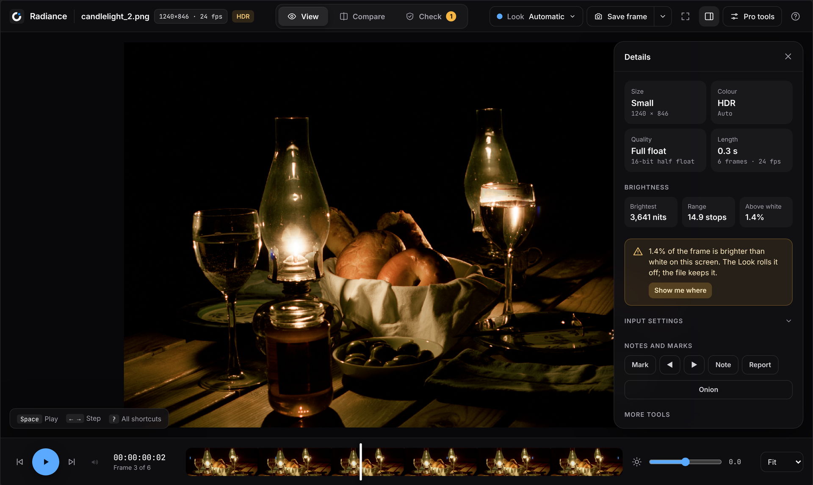
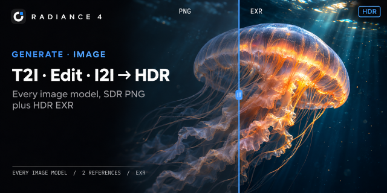
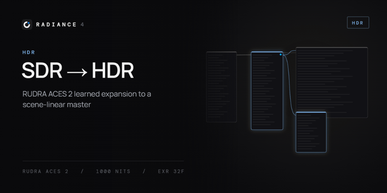
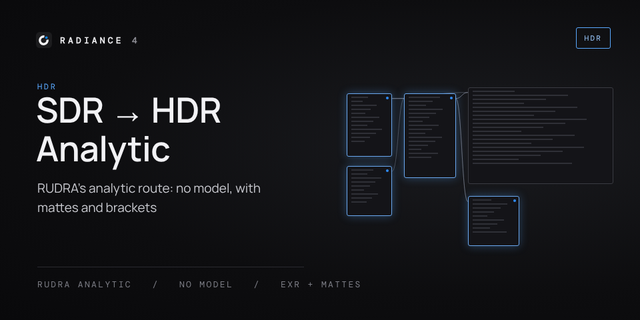
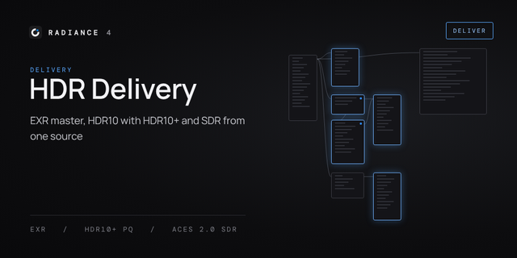
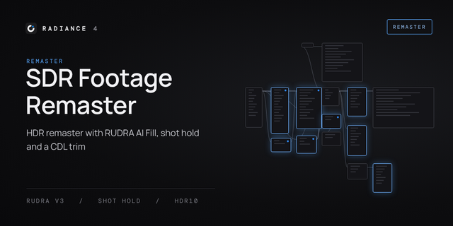
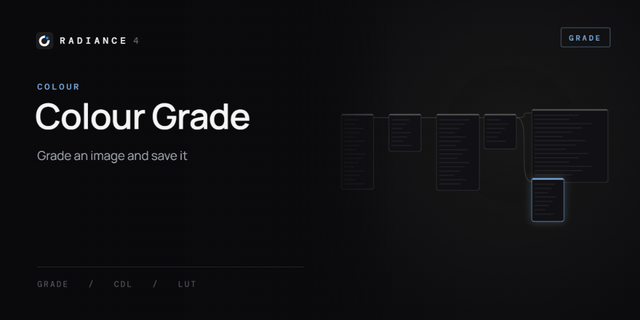
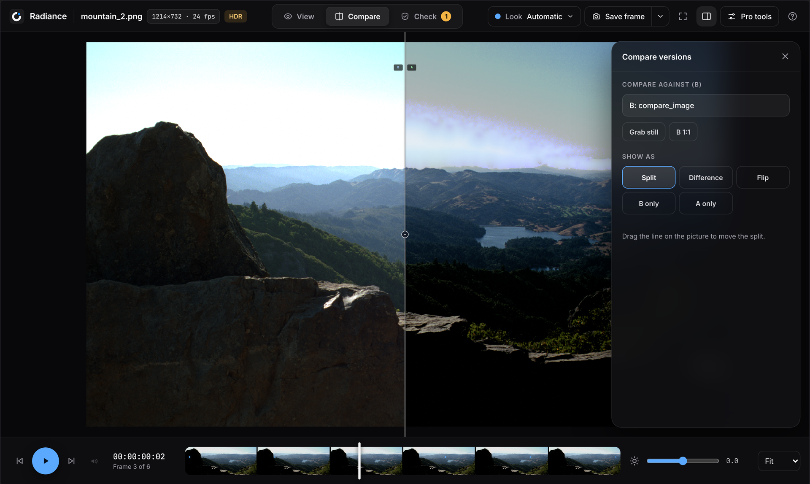

<div align="center">

<picture>
  <source media="(prefers-color-scheme: dark)" srcset="assets/radiance-logo-dark.svg">
  <source media="(prefers-color-scheme: light)" srcset="assets/radiance-logo-light.svg">
  
</picture>

### HDR, colour and VFX review for ComfyUI

Generate in HDR, grade and review like a finishing suite, and deliver masters to Nuke and DaVinci Resolve,<br>without leaving ComfyUI.

[](CHANGELOG.md)
[](CHANGELOG.md)
[](https://registry.comfy.org/nodes/radiance)
[](https://registry.comfy.org/nodes/radiance)
[](#what-you-need)
[](LICENSE)

**[Install](#install)** &nbsp;·&nbsp; **[First HDR image](#your-first-hdr-image)** &nbsp;·&nbsp; **[Workflows](#example-workflows)** &nbsp;·&nbsp; **[Viewer](#using-the-viewer)** &nbsp;·&nbsp; **[Help](#help)**

<br>



<sub>A real HDR photograph in the Viewer (OpenEXR sample image, © 2004 Industrial Light &amp; Magic).</sub>

</div>

<br>

Radiance adds HDR to ComfyUI: **generate** with FLUX 3 Klein, Qwen-Image, Wan and LTX, **turn SDR into HDR** with RUDRA, **review** it in a Viewer built for the picture, and **deliver** EXR, HDR10 and ProRes masters to Nuke and Resolve.

## Install

**With ComfyUI Manager** (recommended)

1. Open **ComfyUI Manager** and search for **Radiance**.
2. Click **Install**.
3. Restart ComfyUI and refresh your browser.

<details>
<summary><b>Install manually with Git</b></summary>
<br>

Run these with the Python that runs ComfyUI:

```sh
cd ComfyUI/custom_nodes
git clone https://github.com/fxtd-studios/radiance.git
cd radiance
python -m pip install -r requirements.txt
```

**Windows portable:** use ComfyUI's bundled `python_embeded\python.exe` instead of `python`.

Restart ComfyUI and refresh your browser.

</details>

<details>
<summary><b>Update</b></summary>
<br>

Click **Update** in ComfyUI Manager, or inside the `radiance` folder:

```sh
git pull
python -m pip install -r requirements.txt
```

Restart ComfyUI and refresh your browser. Back up your workflows before a major update.

</details>

### What you need

| You need | Why |
|---|---|
| A recent **ComfyUI** | FLUX 3 Klein needs 0.41.1 or later; the prompt upsampler needs a Generate Text node with a system prompt |
| **ffmpeg** | For video: on the PATH, the `imageio-ffmpeg` package, or `RADIANCE_FFMPEG` pointing at it |
| **OpenColorIO 2.5+** | For the reference ACES 2.0 output transform (older versions fall back to an approximation and say so) |
| **Disk space** | Some tools download models on first use; Multipass Estimate downloads the most |

## Your first HDR image

Three ways in. Each one is a ready-made workflow: drag the file onto the ComfyUI canvas, or open it from **Templates › Radiance** or from **Radiance › Workflows** (the Radiance button in the top bar).

<table>
<tr>
<td width="33%" valign="top">

### From a photo or SDR video

Open [SDR to HDR](workflows/sdr_to_hdr.json).

1. Pick your file in **Read**.
2. Press **Run**. RUDRA ACES 2 (2 MB) downloads the first time.
3. The **Viewer** opens in Compare: drag the line to see what changed.
4. **Write** saves a 32-bit EXR master.

</td>
<td width="33%" valign="top">

### Without a model

Open [SDR to HDR, analytic](workflows/sdr_to_hdr_analytic.json).

1. Pick a photo in **Load still**: its colour profile and orientation are read for you.
2. Press **Run**. Nothing downloads; any GPU, or none.
3. In the Viewer, **Check › Rebuilt by AI** shows what was reconstructed.
4. **RUDRA Master Write** saves the EXR, its mattes and −2 / 0 / +2 EV brackets.

</td>
<td width="33%" valign="top">

### Generate one

1. Drag the [starter workflow](workflows/t2i_i2i_hdr.json) onto the canvas.
2. Pick the model files in the **Loader** ([which files?](docs/MODELS.md#flux2-klein-starter-workflow)).
3. Type your prompt and press **Run**.
4. Review it in the **Viewer**; its **Write** nodes save an SDR PNG and an HDR EXR master.

For another model, pick its preset in the Loader. The Sampler sets its steps and CFG for you.

</td>
</tr>
</table>

## Example workflows

Drag a file onto the ComfyUI canvas, or open it from **Templates › Radiance** or from **Radiance › Workflows** (the Radiance button in the top bar).

<table>
<tr><td width="33%" valign="top"><a href="workflows/t2i_i2i_hdr.json"></a><br><b><a href="workflows/t2i_i2i_hdr.json">Text to image, edit, image to image</a></b><br>Generate or edit an image, into an SDR PNG and an HDR master</td><td width="33%" valign="top"><a href="workflows/sdr_to_hdr.json"></a><br><b><a href="workflows/sdr_to_hdr.json">SDR to HDR</a></b><br>A photo or video to an ACES 2.0 HDR master, optional AI fill</td><td width="33%" valign="top"><a href="workflows/sdr_to_hdr_analytic.json"></a><br><b><a href="workflows/sdr_to_hdr_analytic.json">SDR to HDR, analytic</a></b><br>SDR to HDR with no model, on any GPU</td></tr>
<tr><td width="33%" valign="top"><a href="workflows/hdr_delivery.json"></a><br><b><a href="workflows/hdr_delivery.json">HDR delivery</a></b><br>EXR, HDR10 with HDR10+, and SDR from one master</td><td width="33%" valign="top"><a href="workflows/sdr_remaster_ai_fill.json"></a><br><b><a href="workflows/sdr_remaster_ai_fill.json">SDR remaster with AI fill</a></b><br>SDR footage to an HDR remaster (16 GB GPU)</td><td width="33%" valign="top"><a href="workflows/colour_grade.json"></a><br><b><a href="workflows/colour_grade.json">Colour grading</a></b><br>Grade an image and save it</td></tr>
</table>

**[See all 40 workflows →](docs/WORKFLOWS.md)** 15 run on your own GPU; 25 generate with a ComfyUI API node (Nano Banana, Seedance, Veo, Kling…) and lift the result to HDR.

## Using the Viewer

The Viewer puts the picture first. Pick a task in its header; a panel floats over the picture and follows it.

| Task | Use it to |
|---|---|
| **View** | See what the frame is and how bright it gets, with a warning when parts are brighter than your screen |
| **Compare** | Put two versions against each other: Split, Difference, Flip |
| **Check** | Find what needs a look, in plain sentences, with overlays like the exposure map and Rebuilt by AI |
| **Pro tools** | Grade, masks, effects, scopes, pixel probe, full QC, and Deliver Master |

<p align="center"></p>

Viewer changes affect the preview only, never your files. **[Viewer guide, shortcuts and delivery →](docs/VIEWER.md)**

## Models

| Model | Best for | Downloads |
|---|---|---|
| **RUDRA** | Turning SDR into HDR (the learned ACES 2 model, a no-model analytic route, AI fill for blown highlights) | automatic, 2 MB (AI fill: 271 MB + 7.7 GB, 16 GB GPU) |
| **FLUX.2 Klein** | Getting started, fast drafts (4 steps) | partly automatic |
| **FLUX 3 Image Klein** | Quality, editing with up to 10 references, layouts | manual, gated |
| **Qwen-Image 2.1** | Editing with up to 16 references, transparency | automatic |

Every automatic download is pinned and hash-checked; `RADIANCE_ALLOW_DOWNLOADS=0` turns them off. **[Files, folders and licences →](docs/MODELS.md)**

## What's new in 4.0

- **Viewer V5:** the picture first, three tasks in plain words, Pro tools when you need them.
- **RUDRA:** SDR → HDR with the learned ACES 2 model or with no model at all, plus HDR10+ / Dolby Vision metadata, shot hold and the Rebuilt by AI overlay.
- **New models:** FLUX 3 Image Klein, Qwen-Image 2.1 and a prompt upsampler; **Deliver Master** with a render queue.

Coming from 3.x? Read the [upgrade notes and full changelog](CHANGELOG.md).

## Help

Something not working? Try these first:

1. Restart ComfyUI and refresh your browser.
2. Look in the ComfyUI console for errors or missing packages.
3. Make sure the requirements went into ComfyUI's own Python.

Still stuck? [Open an issue](https://github.com/fxtd-studios/radiance/issues) with your Radiance and ComfyUI versions, your operating system, the error message and a small workflow that shows the problem.

### Learn more

- **[Radiance website](https://www.fxtdstudios.com/radiance-comfyui.html)**: guides and tutorials
- **[Wiki](https://github.com/fxtd-studios/radiance/wiki)**: how-tos and troubleshooting
- **[Node reference](docs/nodes/README.md)**: all 121 visible nodes and their inputs
- **[Changelog](CHANGELOG.md)**: what changed and upgrade notes
- **[Known issues](KNOWN_ISSUES.md)**: current limits (long-video windowing, estimated passes)

Tip: in ComfyUI, hover over any node or input to read what it does.

## License

Radiance is licensed under [GPL-3.0](LICENSE). Model weights have their own licences; check them before you use or share them.

The Viewer screenshots use the OpenEXR sample images (Candlelight / StillLife, MtTamWest, Desk), © 2004 Industrial Light & Magic, under the [OpenEXR images licence](docs/images/LICENSE-openexr-images.txt).

<div align="center">
<br>
Made by <a href="https://fxtdstudios.com"><b>FXTD Studios</b></a>
</div>
