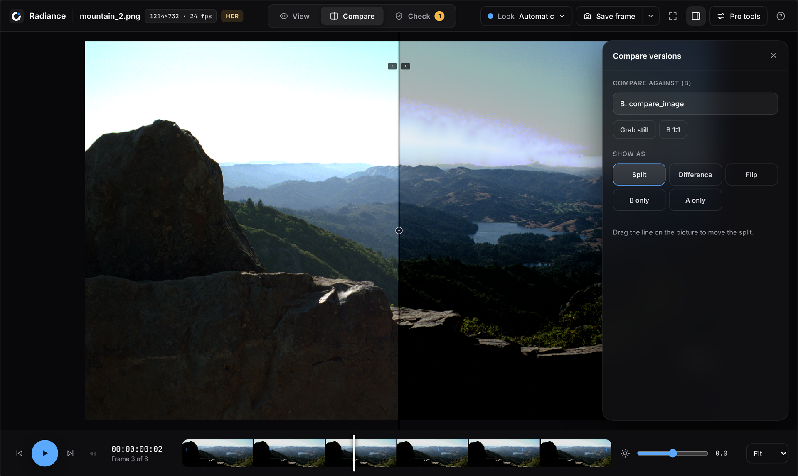
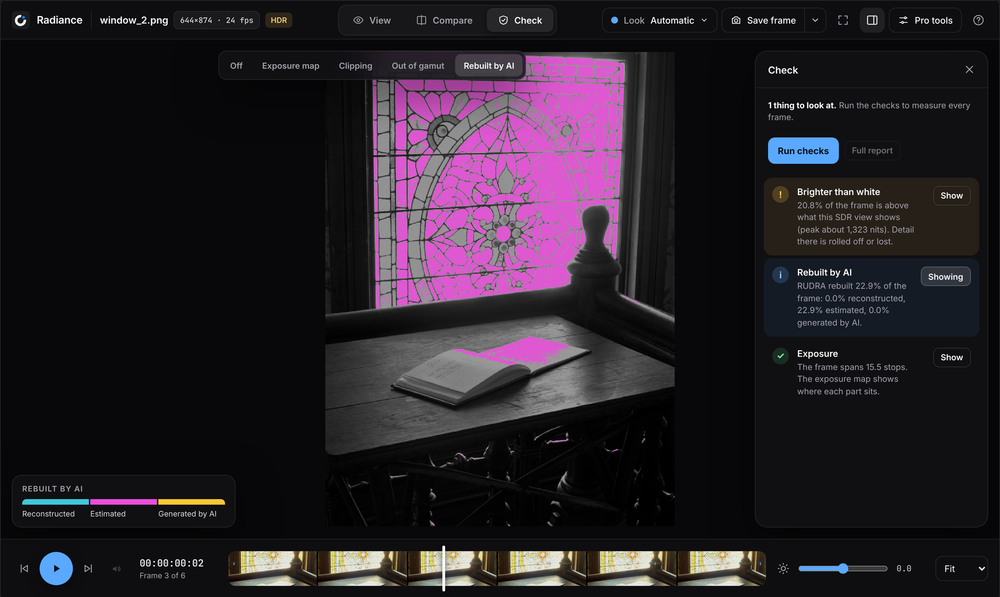

[← Back to the README](../README.md)

# Using the Viewer

The Viewer puts the picture first. Its header has three tasks, in plain words; a panel floats over the right of the picture and follows the task (the panel button in the header hides it).

| Task | Use it to |
|---|---|
| **View** | Look at the frame: size, colour, how bright it gets (with a warning when parts are brighter than your screen shows), the node's input settings, notes and bookmarks |
| **Compare** | Put B against A: the compare_image input or a still you grab. Split (drag the line), Difference, Flip, B only or A only |
| **Check** | What needs a look, in sentences: run the checks over every frame (broken pixels, range, alpha, flicker), then show an overlay: exposure map, clipping, out of gamut, or **Rebuilt by AI** |
| **Pro tools** | The full layout: **Color** (grade, masks, effects, scopes), **Inspect** (channels, pixel probe, analysis) and **QC** (every check and flagged frame) |

 <b>Compare:</b> an SDR photo against its HDR master, sky recovered. <b>Check:</b> Rebuilt by AI on a clipped stained-glass window.

- **Look** (header) sets how the picture is shown on this screen: Film (ACES 2.0), Plain, TV (Rec.709), Filmic or Custom. It changes the preview, never the file.
- **Preview brightness** (the sun slider under the picture) is labelled *not saved* on the picture while it is on.
- **Grade on** appears at the top left when the Viewer's own grade is not neutral, with **Edit** and **Reset**, so a darker or tinted picture always has a reason on screen.
- **Rebuilt by AI**: connect the `regions` output of **SDR → HDR Analytic (RUDRA)** to the Viewer's `regions` input. Check then colours what was reconstructed (cyan), estimated (magenta) or generated (yellow), and says how much of the frame each covers.
- **Save frame** saves the frame as a PNG; the arrow beside it has the other exports.
- In a small node the panel starts closed and the labels shrink to icons; **full screen** gives you the whole layout.

<b>Handy keys</b> (hover the Viewer first; <b>H</b> or <b>?</b> lists them all)

 

| Key | Does |
|---|---|
| **F** | Fit the picture |
| **X** | Compare on or off (opens the Compare task) |
| **D** | Bookmark this frame |
| **,** and **.** | Previous / next bookmark |
| **T** | Write a note on this frame |
| **Alt + drag** | Draw on the frame |
| **Alt + 1…7** | Open a Pro tools panel (Inspector … QC) |

- **Pro tools › Tools › FLUX 3 Layout Boxes** draws layout boxes on the picture and sends them to the Prompt.
- **Pro tools › File › Deliver Master…** exports the graded result (see Delivering masters below).
- Viewer adjustments change the preview only, until you deliver or add the same processing to the workflow.
- WebGL is the default renderer. WebGPU is experimental and lists what it can't do yet.

## Delivering masters

- **Write** saves images, sequences (EXR, PNG, TIFF, DPX) and video from the graph.
- **Deliver Master** (Viewer › **Pro tools › File › Deliver Master…**) exports with the Viewer's grade baked in: ACES, camera log, PQ (HDR10) or HLG, with CDL and AMF sidecars and automatic versioning.
- **Render queue:** set up a version, **Add to Queue**, repeat, then **Start Queue**. A failed job doesn't stop the rest.
- **HDR:** PQ and HLG need 10-bit or float, so 8-bit formats are disabled for them. H.265 10-bit carries HDR10 metadata with the mastering display you choose; scene-linear 1.0 sits at 203 nits (BT.2408).
- **Checks before writing:** frames with NaN or infinite pixels are refused, and HDR QC reports the peak and how much clips.
