[← Back to the README](../README.md)

# Example workflows

Drag a file onto the ComfyUI canvas to open it. There are two kinds: **local** workflows run models on your own GPU, and **API** workflows (`api_*.json`) generate with a ComfyUI API node and do the HDR work locally. All of them are in `workflows/`, so they also appear in ComfyUI's Templates menu under Radiance.

## Local workflows

Each one is a card in Radiance › Workflows and a file in ComfyUI's Templates menu. Click a card to open the workflow file.

<table>
<tr><td width="50%" valign="top"><a href="../workflows/t2i_i2i_hdr.json">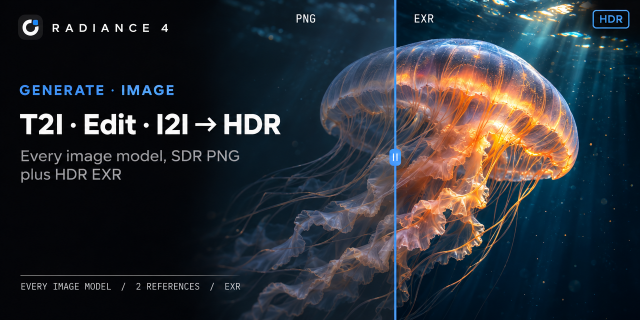</a> <b><a href="../workflows/t2i_i2i_hdr.json">Text to image, edit, image to image</a></b> One workflow for still-image models (Flux.3 Klein, Flux.2, Qwen-Image, Z-Image): text to image, edit with up to two references, or image to image, into an SDR PNG and an HDR EXR master</td><td width="50%" valign="top"><a href="../workflows/sdr_to_hdr.json">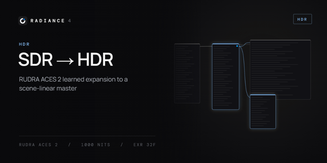</a> <b><a href="../workflows/sdr_to_hdr.json">SDR to HDR</a></b> Turn an image into an ACES 2.0 HDR master with RUDRA, compare it with the SDR and save EXR; optional RUDRA AI fill for large blown highlights (16 GB GPU)</td></tr>
<tr><td width="50%" valign="top"><a href="../workflows/sdr_to_hdr_analytic.json">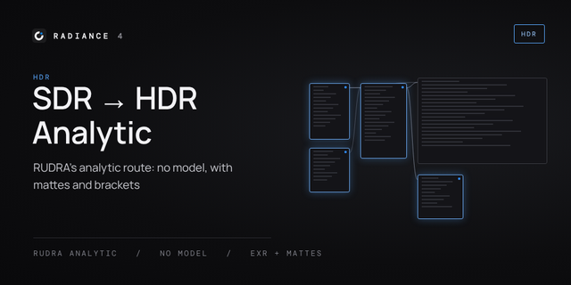</a> <b><a href="../workflows/sdr_to_hdr_analytic.json">SDR to HDR, analytic</a></b> A photo to an HDR master with RUDRA's analytic route (no model, any GPU): colour profile read, clip fill, region, Rebuilt by AI in the Viewer, and an EXR with mattes, brackets and a sidecar; an optional AI fill v5 region re-render (16 GB GPU)</td><td width="50%" valign="top"><a href="../workflows/colour_grade.json">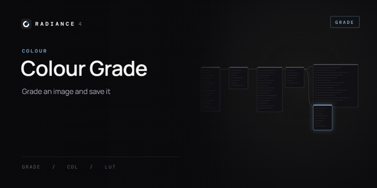</a> <b><a href="../workflows/colour_grade.json">Colour grading</a></b> Grade an image and save it</td></tr>
<tr><td width="50%" valign="top"><a href="../workflows/hdr_vae_encode_decode.json">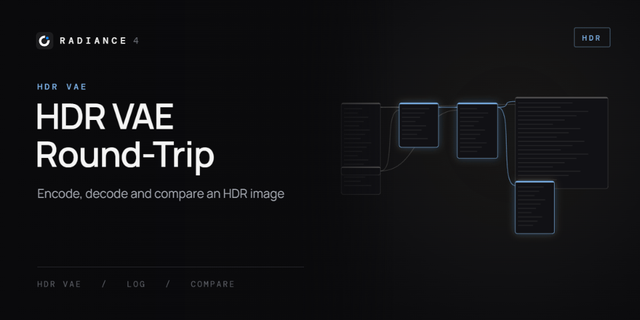</a> <b><a href="../workflows/hdr_vae_encode_decode.json">HDR VAE</a></b> Encode, decode and compare an HDR image</td><td width="50%" valign="top"><a href="../workflows/multipass_relight.json">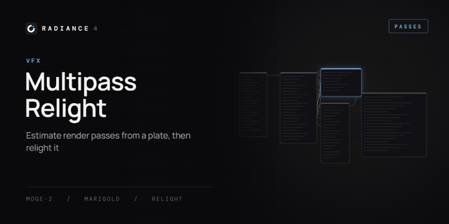</a> <b><a href="../workflows/multipass_relight.json">Multipass relighting</a></b> Estimate passes and relight</td></tr>
<tr><td width="50%" valign="top"><a href="../workflows/hdr_delivery.json">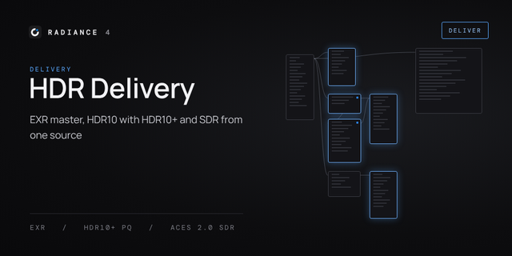</a> <b><a href="../workflows/hdr_delivery.json">HDR delivery</a></b> EXR master, HDR10 peak-fitted to 1000 nits with HDR10+ / Dolby Vision metadata carried in the file, and SDR</td><td width="50%" valign="top"><a href="../workflows/wan_hdr.json">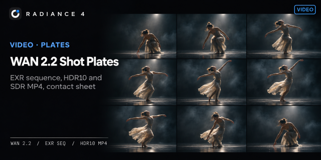</a> <b><a href="../workflows/wan_hdr.json">Wan</a></b> Text or image to video (first and last frames) with Wan 2.2 (14B or 5B) or Wan 2.1, with a Turbo LoRA in 4 steps or the full 20 and an optional frame interpolation to 32 fps, into an EXR master; HDR10 and SDR MP4s and a contact sheet ready but bypassed</td></tr>
<tr><td width="50%" valign="top"><a href="../workflows/sdr_remaster_ai_fill.json">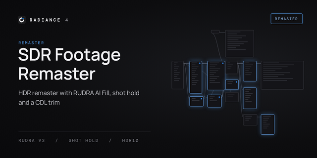</a> <b><a href="../workflows/sdr_remaster_ai_fill.json">SDR remaster with AI fill</a></b> SDR footage to an HDR remaster: suggested AI fill prompts, RUDRA AI fill, shot hold, a flicker report, CDL trim, EXR, HDR10 and SDR (16 GB GPU)</td><td width="50%" valign="top"><a href="../workflows/shot_look_match.json">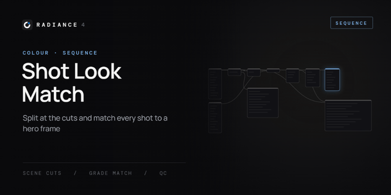</a> <b><a href="../workflows/shot_look_match.json">Shot look match</a></b> Split a sequence at its cuts and match each shot to a reference look</td></tr>
<tr><td width="50%" valign="top"><a href="../workflows/ltx23_hdr.json">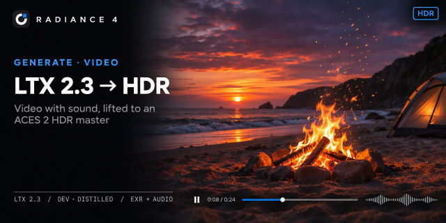</a> <b><a href="../workflows/ltx23_hdr.json">LTX 2.3</a></b> Text or image to video with sound, Dev or Distilled, in two passes, into an EXR master with RUDRA ACES 2; keyframes, a low-res preview and HDR10 and SDR MP4s ready but bypassed</td><td width="50%" valign="top"><a href="../workflows/ltx23_3stage_hdr.json">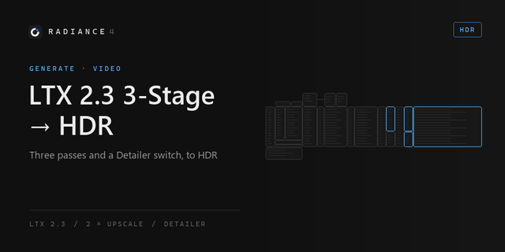</a> <b><a href="../workflows/ltx23_3stage_hdr.json">LTX 2.3 3-Stage</a></b> The same in three passes (two 2x upscales), with a switch for the Detailer LoRA</td></tr>
<tr><td width="50%" valign="top"><a href="../workflows/ltx25_hdr.json">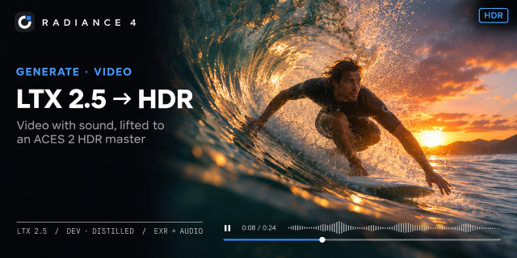</a> <b><a href="../workflows/ltx25_hdr.json">LTX 2.5</a></b> LTX 2.3's two-pass workflow for LTX 2.5</td><td width="50%" valign="top"> <b><a href="../workflows/ltx25_3stage_hdr.json">LTX 2.5 3-Stage</a></b> The three-pass version for LTX 2.5</td></tr>
<tr><td width="50%" valign="top"><a href="../workflows/minimax_h3_hdr.json">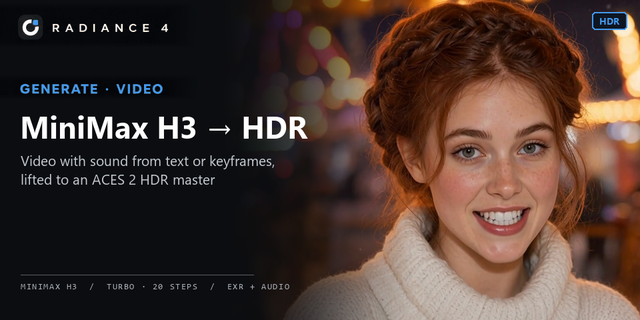</a> <b><a href="../workflows/minimax_h3_hdr.json">MiniMax H3</a></b> Text or image to video with sound (first and last frames), with a Turbo LoRA in 8 steps or the full 20, into an EXR master with RUDRA ACES 2; HDR10 and SDR MP4s ready but bypassed</td><td width="50%" valign="top"></td></tr>
</table>

## API workflows

API workflows generate with a ComfyUI API node (Nano Banana, Seedance, Veo, Kling, GPT Image…), then lift the result to HDR.

Generate with a ComfyUI API (partner) node, then build an ACES 2.0 HDR master with RUDRA. Each one runs SDR → HDR Universal (RUDRA ACES 2) and has SDR → HDR AI Fill (RUDRA v3) ready but bypassed: select it and press Ctrl+B to rebuild large blown highlights. Image workflows save a 32-bit EXR with the master and its `rudra.reconstructed` channel; video workflows save an EXR sequence with a .wav at timecode and an HDR10 MP4. API nodes need a Comfy account and use API credits.

| Image | What it does |
|---|---|
| [Nano Banana → HDR](../workflows/api_nano_banana_hdr.json) | Gemini image, lifted to an ACES 2 HDR master |
| [Seedream 5 → HDR](../workflows/api_seedream_hdr.json) | ByteDance Seedream, lifted to an ACES 2 HDR master |
| [GPT Image → HDR](../workflows/api_gpt_image_hdr.json) | OpenAI GPT Image, lifted to an ACES 2 HDR master |
| [FLUX 3 API → HDR](../workflows/api_flux3_pro_hdr.json) | BFL FLUX 3 Image, lifted to an ACES 2 HDR master |
| [Qwen Image 3 → HDR](../workflows/api_qwen_image_hdr.json) | Qwen Image, lifted to an ACES 2 HDR master |
| [Wan Image → HDR](../workflows/api_wan_image_hdr.json) | Wan text to image, lifted to an ACES 2 HDR master |
| [Ideogram V4 → HDR](../workflows/api_ideogram_hdr.json) | Ideogram, lifted to an ACES 2 HDR master |
| [Recraft V3 → HDR](../workflows/api_recraft_hdr.json) | Recraft realistic image, lifted to an ACES 2 HDR master |
| [Kling Image → HDR](../workflows/api_kling_image_hdr.json) | Kling 3.0 Omni image, lifted to an ACES 2 HDR master |
| [Grok Image → HDR](../workflows/api_grok_image_hdr.json) | Grok Imagine, lifted to an ACES 2 HDR master |
| [Luma UNI-1 → HDR](../workflows/api_luma_image_hdr.json) | Luma image, lifted to an ACES 2 HDR master |

| Video | What it does |
|---|---|
| [Seedance 2.5 → HDR Video](../workflows/api_seedance_hdr.json) | Text to video, each frame lifted with RUDRA |
| [Nano Banana + Seedance → HDR](../workflows/api_nano_banana_seedance_hdr.json) | A Nano Banana still animated by Seedance, then RUDRA |
| [Wan 2.7 → HDR Video](../workflows/api_wan_video_hdr.json) | Wan text to video, each frame lifted with RUDRA |
| [Nano Banana + Wan 3 → HDR](../workflows/api_nano_banana_wan3_hdr.json) | A Nano Banana still animated by Wan 3.0, then RUDRA |
| [Veo 3 → HDR Video](../workflows/api_veo3_hdr.json) | Google Veo, each frame lifted with RUDRA |
| [Kling 3.0 → HDR Video](../workflows/api_kling_video_hdr.json) | Kling Omni text to video, each frame lifted with RUDRA |
| [MiniMax H3 → HDR Video](../workflows/api_minimax_h3_hdr.json) | Hailuo H3 text to video, each frame lifted with RUDRA |
| [Runway Gen-4 → HDR Video](../workflows/api_runway_gen4_hdr.json) | Image to video from your still, then RUDRA |
| [Luma Ray 3.2 → HDR Video](../workflows/api_luma_ray_hdr.json) | Luma Ray text to video, each frame lifted with RUDRA |
| [Vidu Q3 → HDR Video](../workflows/api_vidu_q3_hdr.json) | Vidu text to video, each frame lifted with RUDRA |
| [PixVerse V6 → HDR Video](../workflows/api_pixverse_hdr.json) | PixVerse text to video, each frame lifted with RUDRA |
| [LTX 2.5 API → HDR Video](../workflows/api_ltx25_hdr.json) | LTX 2.5 text to video, each frame lifted with RUDRA |
| [FLUX 3 Video → HDR Video](../workflows/api_flux3_video_hdr.json) | BFL FLUX 3 text to video, each frame lifted with RUDRA |
| [Grok Video → HDR Video](../workflows/api_grok_video_hdr.json) | Grok Imagine video, each frame lifted with RUDRA |
